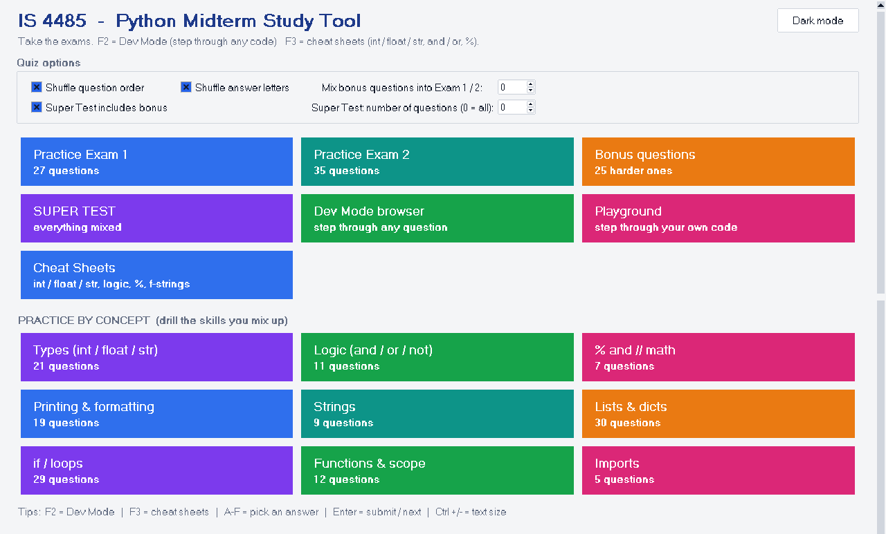
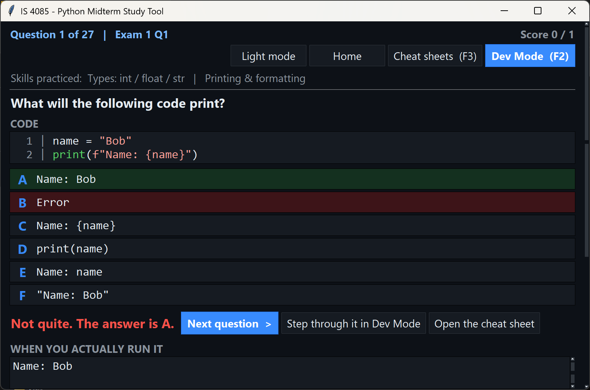
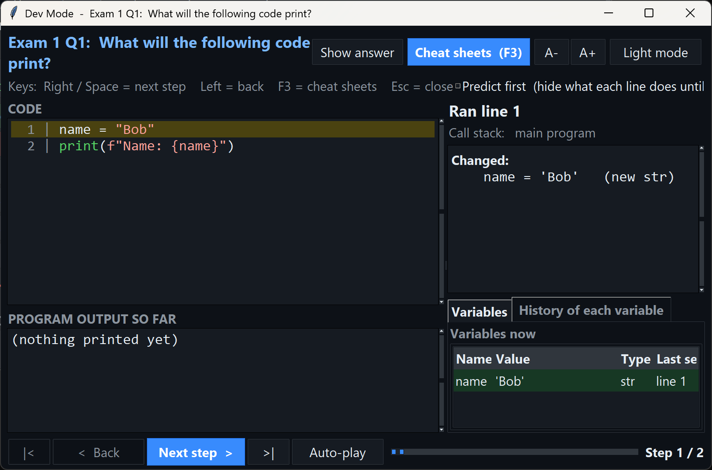
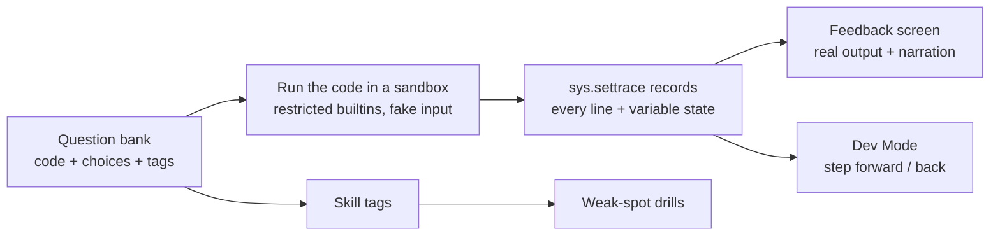

# IS 4085 – Python Midterm Study Tool

An interactive desktop study app for an intro Python midterm. It doesn't just tell you the right answer: it **runs the code**, shows what really happened, and lets you step through it line by line. One self-contained file, Python 3.8+, no installs.



## Features
- **Practice Exam 1** (27 q), **Practice Exam 2** (35 q), 25 harder bonus questions, and a mixed **Super Test**
- **Explains every miss:** what the code actually printed, why the right answer is right, why *your* answer isn't, and a plain-English narration of the program
- **Dev Mode (F2):** a line-by-line debugger showing which value goes into which parameter, the call stack, how each expression was evaluated, every variable's history, and an optional *predict first* mode
- **Cheat sheets (F3):** type conversions, truthiness, `%` and `//`, formatting, strings & lists, all computed live, with a "Try it" box
- **Practice by concept:** every question is tagged with the skills it tests; the results screen shows weak spots with a one-click drill
- Playground for stepping through your own code, light/dark mode, GUI or `--cli` terminal mode

## Screenshots
| Feedback on a wrong answer | Dev Mode stepping through code |
|---|---|
|  |  |

## How it works


## Run it
```bash
python IS4085_Python_Midterm_Study_Tool.py        # GUI
python IS4085_Python_Midterm_Study_Tool.py --cli  # terminal
```
Runs entirely locally: no network access, no files written.
